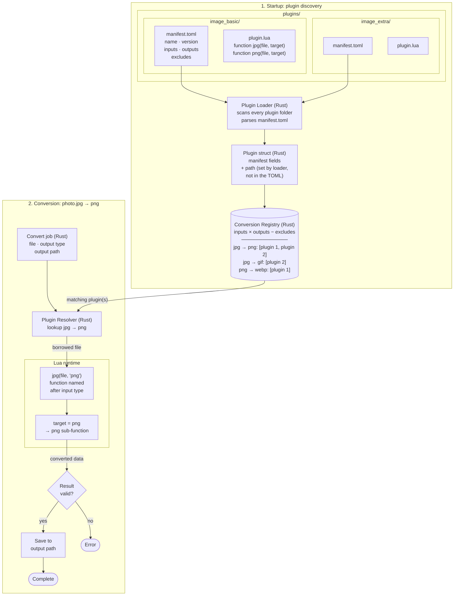
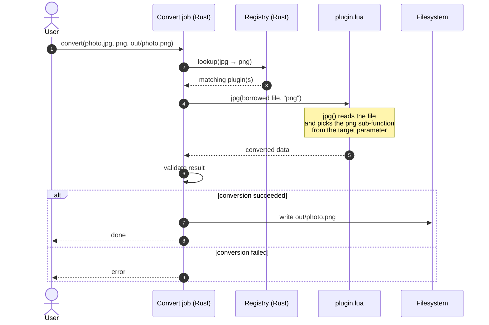

# MeltForge


**Meltforge** is a universal, plugin-based converter for video, audio, images and more.  
It’s **fast**, **extensible**, and **open source** – built with Rust and Slint.

> Drop in your media -> Melt it down -> Forge it into any format you need.

## Elevator Pitch

Meltforge is the **last converter you’ll ever need**.  
It’s designed to be **lightweight by default** and **extendible on demand**:

- Only install the converters you need (video, audio, image, …).
- Use the **built-in Slint desktop UI** for a friendly drag-and-drop workflow.
- Prefer the terminal? The **CLI** is always there, fast and scriptable.
- Add more power with plugins – Meltforge is designed to grow with you.

**One tool, endless conversions.**

# **Meltforge – User Stories & Priorities**

## **Priority 0 (Core – must exist before anything else)**

### 1. CLI Conversion (Single File)

- **Story:**
  _As a power user, I want to run `meltforge convert input.mp4 --to mp3`, so that I can convert media fast from the terminal._
- **Acceptance Criteria:**

  - CLI accepts input file and `--to` flag.
  - Conversion runs successfully and outputs target file.
  - Errors (unsupported format, missing file) are clear and exit with non-zero code.

### 2. Core without UI (Lightweight Base)

- **Story:**
  _As a user, I want Meltforge core to run without UI, so that the default install is lightweight._
- **Acceptance Criteria:**

  - Meltforge builds and runs as CLI only.
  - No Slint/UI dependencies included in minimal build.
  - CLI binary works standalone.

### 3. Plugin Runtime (Discovery & Loading)

- **Story:**
  _As a user, I want Meltforge to auto-load plugins from a `plugins/` folder, so that I only use what’s installed._
- **Acceptance Criteria:**

  - `plugins/` folder is scanned at startup.
  - Compatible plugins are loaded automatically.
  - If a plugin is broken, Meltforge fails gracefully with a clear error.

## **Priority 1 (Usability & First Extensions)**

### 4. CLI Batch Conversion

- **Story:**
  _As a power user, I want to convert multiple files with wildcards, so that I save time on repetitive tasks._
- **Acceptance Criteria:**

  - CLI accepts `*.wav` or multiple inputs.
  - Each file is converted in sequence.
  - Errors don’t stop the whole batch (skip failed, log it).

### 5. UI as Optional Package

- **Story:**
  _As a casual user, I want to install a desktop UI only if I need it, so that I don’t pull unnecessary dependencies._
- **Acceptance Criteria:**

  - UI shipped as a separate binary/package.
  - Meltforge core runs without UI.
  - Installing UI adds drag-and-drop interface.

### 6. Basic UI Drag & Drop

- **Story:**
  _As a casual user, I want to drag & drop files into Meltforge’s UI, so that I can convert easily without CLI._
- **Acceptance Criteria:**

  - User can drop one or multiple files.
  - Output format can be chosen from a dropdown.
  - Progress bar shown per file.
  - Output saved in same folder by default.

### 7. Basic Settings

- **Story:**
  _As a user, I want to configure default output folder and quality, so that I don’t re-select every time._
- **Acceptance Criteria:**

  - Config file (`settings.toml` or similar).
  - Default output directory configurable.
  - Quality/bitrate defaults configurable.

## **Priority 2 (Plugins & Developer Focus)**

### 8. Plugin Management CLI

- **Story:**
  _As a user, I want `meltforge plugin install/remove/list`, so that I can manage plugins on demand._
- **Acceptance Criteria:**

  - CLI command `plugin list` shows installed plugins.
  - `plugin install` downloads from registry or Git URL.
  - `plugin remove` deletes plugin safely.

### 9. Plugin Auto-Discovery in UI/CLI

- **Story:**
  _As a user, I want Meltforge to list available formats from installed plugins, so that I know what’s supported._
- **Acceptance Criteria:**

  - CLI command `meltforge list-formats` shows all formats.
  - UI dropdown auto-updates when plugin is added/removed.

### 10. Plugin SDK (Stable API)

- **Story:**
  _As a developer, I want a stable Rust SDK, so that I can write plugins without touching core._
- **Acceptance Criteria:**

  - `meltforge-plugin-sdk` crate published.
  - Clear traits for input/output/metadata.
  - Versioned API to avoid breaking changes.

### 11. Plugin Template & Docs

- **Story:**
  _As a developer, I want a plugin template and example, so that I can scaffold my plugin fast._
- **Acceptance Criteria:**

  - `cargo generate meltforge-plugin-template`.
  - Example plugin included (e.g., WebP).
  - Docs explaining lifecycle and publishing.

### 12. Plugin Capabilities & Security

- **Story:**
  _As a user, I want plugins to declare capabilities, so that Meltforge can sandbox and prevent misuse._
- **Acceptance Criteria:**

  - Plugin manifest (Name, Version, Capabilities, Dependencies).
  - Meltforge validates manifest at load.
  - Incompatible plugins rejected cleanly.

## **Priority 3 (Nice-to-Have / Future Ideas)**

### 13. Presets

- **Story:**
  _As a user, I want reusable conversion presets (e.g., “WhatsApp 720p”), so that I don’t configure each time._
- **Acceptance Criteria:**

  - CLI: `--preset whatsapp`.
  - UI: preset picker dropdown.
  - Presets stored in config (JSON/YAML).

### 14. Queue & Batch Jobs

- **Story:**
  _As a power user, I want a conversion queue, so that I can stack multiple jobs hands-off._
- **Acceptance Criteria:**

  - CLI: `meltforge queue add input.mp4`.
  - UI: queue list with progress bars.
  - Jobs can be cancelled individually.

### 15. Scripting Configs

- **Story:**
  _As a power user, I want to run conversions from JSON/YAML configs, so that I can automate pipelines._
- **Acceptance Criteria:**

  - CLI: `meltforge run config.yaml`.
  - Config supports multiple files, options, presets.
  - Errors reported per job.

### 16. Plugin Store/Registry

- **Story:**
  _As a developer, I want a plugin registry, so that the community can share and install plugins easily._
- **Acceptance Criteria:**

  - Online index of plugins (GitHub registry or custom).
  - `meltforge plugin search <term>`.
  - Secure download + version checks.

# Planning

## Thinking Process
### Core
The goal of the Core can be split into two parts: The Conversion process and the Plugins that are needed for the conversions. It should not have any ui features only pure functionality.
### Convert
gets the file and what File Type it should have at the end after that the Conversion validates it before converting it and then uses the needed plugin of the File Type it processes the request and returns the file with the desired file type in the desired path.  There are some problems i already see. 
#### Problems
- 3 plugins convert png to jpg which one is used? 
- how do we guarantee a good dev experience for the File types? They can't be an enum because plugins are using them. unless we are limiting the file types of which i know. This would be a unecessary limitation.
### Plugins
It needs a directory with all available plugins. The plugin itself should have a toml file that holds the metadata of the plugin like which file types can be converted to another file type they call this Manifest.
#### Open Questions
How many types can one plugin convert? one type to another type? or one type to many other types? or many types to one type? Or Many Types to Many Types?. Depending on that the plugins language api has to be written differently 
What Lang does the Plugins support? I personally want it to support Lua but i definetly want to make it modular enough so multiple languages are possible. Maybe support a simple bin that just gets executed with the exact inputs? I have to get more infos on how to write a Plugin System
## Core Features
### Convert
Parameters:
- File
- desired file type
- Desired plugin?
- output path
Converts the file in the desired type and desired path path has a standard output path that can either be configured or 
### Plugins
- define supported file types in manifest with excludelist
- version
- gets the file itself with file type of the file and the file type of the desired file type
- then selects the right command for the selected file types and converts them to the desired type.

## Plugin Architecture

Meltforge itself does not know how to convert any file format. Every conversion is provided by a **plugin**: a small folder containing a manifest that describes what the plugin can do, and a Lua script that does the actual work. The Rust core is responsible for discovering plugins, choosing the right one for a job, and safely handling files before and after the conversion.

### Overview



### How it works

**1. Plugin structure**

Each plugin lives in its own folder inside `plugins/` and contains two files:

- `manifest.toml` declares the plugin's `name`, `version`, the file types it accepts (`inputs`), the file types it can produce (`outputs`), and any combinations it does not support (`excludes`, e.g. `jpg → gif`).
- `plugin.lua` contains one Lua function per input type. The function is named after the input file type (`jpg`, `png`, ...) and receives the target format as a parameter.

**2. Discovery at startup**

When Meltforge starts, the plugin loader scans every folder in `plugins/` and parses its `manifest.toml` into a `Plugin` struct. The folder path is not part of the TOML file; the loader adds it to the struct so Meltforge knows where to find the plugin's Lua script later.

**3. Building the registry**

From all loaded plugins, Meltforge builds a conversion registry. For every plugin it combines each input with each output, removes the combinations listed in `excludes`, and records which plugin can handle each pair. The result is a lookup table such as:

```
jpg → png:  [image_basic, image_extra]
jpg → gif:  [image_extra]
png → webp: [image_basic]
```

Several plugins can offer the same conversion, so each entry holds a list of plugins.

**4. Running a conversion**

A convert job carries three things: the source file, the desired output type, and the output path. The resolver looks up the pair (e.g. `jpg → png`) in the registry and selects a plugin. Meltforge then calls the Lua function named after the source type, `jpg(file, "png")`. Inside that function, the `"png"` parameter tells the plugin which sub-function to use.

Lua only receives a **borrowed** reference to the file. It reads it, converts it, and hands the converted data back to Rust. It never writes to disk itself.

**5. Validation and output**

Back in Rust, Meltforge checks that the conversion succeeded. If it did, the result is written to the requested output path and the job is complete. If not, an error is reported and nothing is written.

### Conversion flow (`jpg → png`)



### Example `manifest.toml`

```toml
name    = "image_basic"
version = "1.0.0"
inputs  = ["jpg", "png"]
outputs = ["png", "jpg", "gif", "webp"]

# skip specific input → output combinations
excludes = [
    { input = "jpg", output = "gif" },
]
```